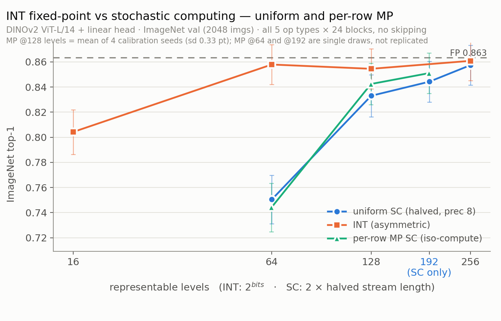

# INT fixed-point vs uniform SC — matched-precision sweep (ViT)

DINOv2 ViT-L/14 + linear head, ImageNet-1k val, **2048-image seeded subset**,
`--seed 0`. Run 2026-07-25 on gl1804. Uniform only — **no mixed precision, no
hybrid, no skipping**: every cell puts all 5 op types (`qk`, `av`, `mlp_fc1`,
`mlp_fc2`, `proj`) on all 24 blocks. Patch embed and the classifier head stay
FP in every cell.

Driver `cls/run_int_vs_sc.sh` · table `cls/collect_int_vs_sc.py` · figure
`figs/plot_int_vs_sc.py` · raw `results/int_vs_sc/`.

## Convention

**Halve ON, `sc_prec=8` → a constant 128-level quantization grid; the stream
length is the compute knob.** By the bipolar sign-magnitude halving identity
(wu-hpca2022) a length-`L` halved stream carries the resolution of a `2L`-level
representation at `L` cycles, so both families plot on one axis — *number of
representable levels*:

| halved stream | effective levels | INT equivalent |
|---|---|---|
| 32 | 64 | int6 |
| 64 | 128 | int7 |
| 96 | 192 | *(no power-of-two INT)* |
| 128 | 256 | int8 ← grid ceiling |

## INT protocol — ported from scmp_llm, not scmp_cnn

`model/int_vit.py` reimplements scmp_llm's `benchmark/quant/ptq.py`: RTN
quantize→dequantize, per-token activation scale, per-output-row weight scale,
and — the part that matters — **scales taken per 128-wide chunk of the
reduction dimension**, because `_fake_quant_lastdim_chunks`'s whole purpose is
to "match the SC linear fast path's `chunk_d=128` scale scope". vit_sc's SC
linears run `chunk_d=128`, so the INT baseline must chunk identically or the
comparison is measuring scale granularity instead of the MAC.

Two deliberate deviations, both flagged rather than silently taken:

1. **Attention scale scope.** scmp_llm quantizes QK/AV operands *per row* while
   its SC attention runs `per_head` — INT gets a finer scope than SC. In an LLM
   attention is a small share of FLOPs; on a ViT it is not, and the mismatch
   would flatter INT. Default here is `per_head` for QK, matching SC.
   `--int_attn_scope per_row` reproduces scmp_llm's literal behaviour.
2. **SmoothQuant is off on both sides.** scmp_llm's protocol runs α=0.5 for INT
   *and* SC. vit_sc's SC path passes `smooth_scales=None`, so enabling it for
   INT alone would compare quantizers, not arithmetic. Turn it on for both or
   neither.

## Results

FP ceiling **0.8633**. Error is the 95% Wilson half-width at n=2048 — **±1.5 pt**
across this accuracy range.

| config | levels | top-1 | vs FP | img/s |
|---|---:|---:|---:|---:|
| FP | — | 0.8633 | — | 245.0 |
| int8 asymm | 256 | 0.8608 | −0.24 | 139.3 |
| int8 symm | 256 | 0.8584 | −0.49 | 166.4 |
| **SC halved-128** | **256** | **0.8574** | −0.59 | 6.0 |
| **SC halved-96** | **192** | **0.8442** | −1.90 | 6.5 |
| int7 symm / asymm | 128 | 0.8545 | −0.88 | 166.2 / 139.6 |
| **SC halved-64** | **128** | **0.8330** | −3.03 | 7.0 |
| int6 asymm | 64 | 0.8579 | −0.54 | 139.4 |
| int6 symm | 64 | 0.8501 | −1.32 | 166.5 |
| **SC halved-32** | **64** | **0.7505** | −11.28 | 8.2 |
| int4 asymm | 16 | 0.8042 | −5.91 | 139.2 |
| int4 symm | 16 | 0.2793 | −58.40 | 166.6 |

### Matched precision

| levels | INT symm | INT asymm | uniform SC | SC − INT symm |
|---:|---:|---:|---:|---:|
| 256 | 0.8584 | 0.8608 | 0.8574 | **−0.10** |
| 192 | — | — | 0.8442 | *SC-only point* |
| 128 | 0.8545 | 0.8545 | 0.8330 | **−2.15** |
| 64 | 0.8501 | 0.8579 | 0.7505 | **−9.96** |
| 16 | 0.2793 | 0.8042 | — | — |

The figure plots **asymmetric** INT only — it is the better scheme at every
level here, so showing both curves spent the y-axis on a quantizer-config
artifact (int4 symmetric at 0.279) instead of on the SC-vs-INT comparison. The
full symm/asymm split stays in the table above. Regenerate the two-curve
version with `python figs/plot_int_vs_sc.py results/int_vs_sc both`.

## Findings

1. **INT ≥ uniform SC at every matched level, and the gap widens sharply as
   precision drops** — −0.10 at 256 levels, −2.15 at 128, −9.96 at 64. This is
   the ViT reproduction of scmp_cnn's finding #1, with the same shape. A
   length-32 stream is a 32-sample estimate of each dot product; a deterministic
   64-level integer MAC has no such variance. This is the price of bit-serial SC
   and it is expected.
2. **At 256 levels the two are indistinguishable** (0.8574 vs 0.8584, −0.10 pt
   against a ±1.5 pt interval). Uniform SC is essentially free at the grid
   ceiling on this model.
3. **int4 symmetric collapses; int4 asymmetric does not — 0.2793 vs 0.8042, a
   52.5 pt gap.** Far outside noise, and a decisive confirmation of scmp_llm's
   "asymm beats symm below W6A6". With only 16 codes, forcing zero-point = 0
   spends half of them on a sign range that post-GELU and post-softmax tensors
   never occupy. **Any int4 row quoted for this model must be asymmetric**, or
   it reports a quantizer bug rather than a precision limit.
4. **192 levels is a point fixed-point cannot express** (0.8442). SC reaches it
   by early-terminating one `sc_prec=8` Sobol stream at 96 cycles — no datapath
   change. That non-power-of-two budget knob is the SC granularity argument;
   matched-precision accuracy is not.
5. **Wall-clock does not track `stoc_len`** (6.0 → 8.2 img/s from 128 down to
   32 cycles). SC cost here is `cum_indicator` build + Triton launch overhead.
   `stoc_len` is an energy/area axis; never quote GPU latency as the SC compute
   budget.

## Caveats

- **n=2048 → ±1.5 pt.** The 256-level tie and the 128-level −2.15 gap are both
  inside ~1.4σ — suggestive, not established. Only the 64-level gap (−9.96) and
  the int4 symm/asymm split (−52.5) are decisive at this sample size. Publishable
  numbers need the full 50 k val set.
- INT is non-monotonic in the noise band (int6 asymm 0.8579 > int7 asymm
  0.8545). That ordering is not real at this n.
- No SmoothQuant, no MP, no per-block scheduling, no QwT compensation — all of
  those move these curves and are separate experiments.
- INT rows are **fake-quant**: quantize→dequantize with an fp32 matmul. They
  measure quantization error, not integer-datapath throughput.
